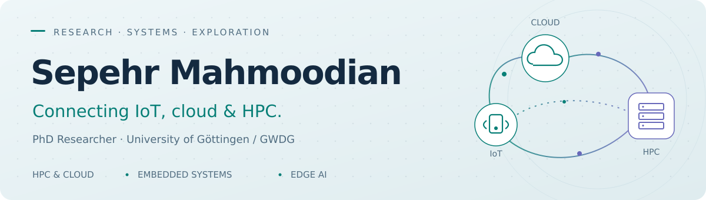
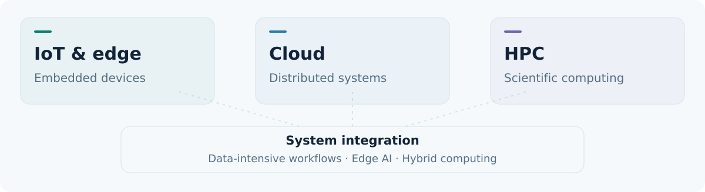

<picture>
  <source media="(prefers-color-scheme: dark)" srcset="assets/banner-dark.svg">
  <source media="(prefers-color-scheme: light)" srcset="assets/banner-light.svg">
  
</picture>

  <a href="https://sephorizon.com/"><strong>Portfolio & photography</strong></a> &nbsp;·&nbsp;
  <a href="https://hps.vi4io.org/about/people/sepehr_mahmoodian">Research profile</a> &nbsp;·&nbsp;
  <a href="https://www.linkedin.com/in/sepehr-mahmoodian">LinkedIn</a> &nbsp;·&nbsp;
  <a href="https://orcid.org/0009-0000-0569-8047">ORCID</a>

I’m **Sepehr**, a PhD researcher in Computer Science at the **University of Göttingen and GWDG**, Germany. I’m interested in how **IoT, cloud infrastructure, and high-performance computing** come together in practical systems.

My background spans computer architecture, embedded systems, IoT engineering, and university teaching. I enjoy working across hardware and software—and making complex ideas easier to explore.

## What I’m working on

*Updated October 2026*

| Area | Current focus |
| :--- | :--- |
| **HPC & cloud** | Researching system integration, data-intensive workflows, and the convergence of cloud and high-performance computing. |
| **Edge AI** | Supervising student projects on lightweight Kubernetes, Raspberry Pi deployments, and resource-efficient AI applications. |
| **Teaching & mentoring** | Supporting hands-on learning in embedded systems, computer architecture, and practical AI deployment. |
| **Sephorizon** | Developing [my personal website](https://sephorizon.com/) for research, projects, teaching, nature photography, and 360° views. |

## My research landscape

<picture>
  <source media="(prefers-color-scheme: dark)" srcset="assets/research-map-dark.svg">
  <source media="(prefers-color-scheme: light)" srcset="assets/research-map-light.svg">
  
</picture>

## Tools across my work

<picture>
  <source media="(prefers-color-scheme: dark)" srcset="assets/tools-dark.svg">
  <source media="(prefers-color-scheme: light)" srcset="assets/tools-light.svg">
  
</picture>

## Beyond the terminal

I enjoy **nature photography, drone footage, and 360° perspectives**. I’m bringing these interests together with research and teaching on [**sephorizon.com**](https://sephorizon.com/).

Interested in HPC/cloud integration, embedded systems, or edge AI? [**Get in touch**](mailto:s.mahmoodian@gwdg.de).
